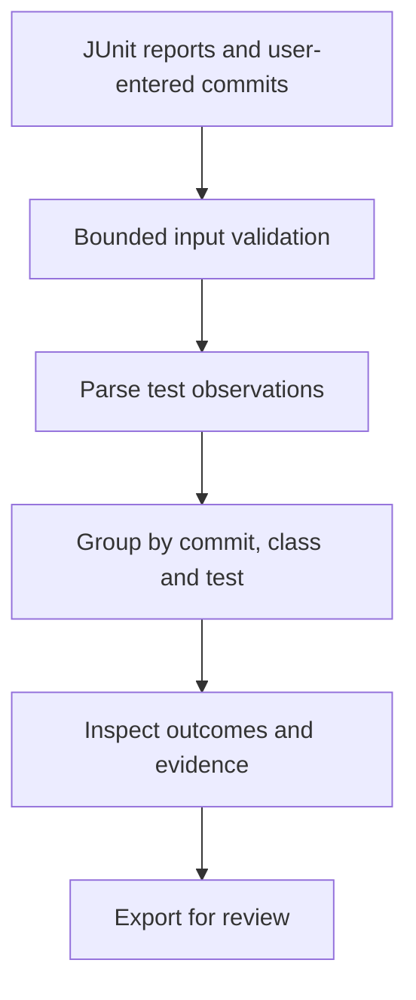

# Flakewise

**Understand why the same CI test can look different across runs.**

A practical workbench for developers who have JUnit XML reports and need to compare actual pass/fail observations. Upload reports, provide the commit identifier for each, inspect individual observations, and prepare evidence to share in a GitLab issue. The bundled sample files are illustrative; bring your own JUnit reports to investigate your work.

## What it does

Flakewise groups tests by the user-supplied commit identifier, test class and test name. A group with at least one pass and one failure is labeled **inconsistent**. Single observations are insufficient evidence; skipped tests remain distinct. Different supplied commit strings are not combined.

Commit identifiers are user assertions. Two results on the same asserted commit may differ because of environment, data or test ordering; they are not proof of test flakiness or its cause. Identical short hashes can collide, so full hashes are preferable. The tool does not connect to GitLab, fetch artifacts, or execute tests automatically.



## Run locally

Python 3.12 is used for the deployment; Python 3.9 or newer is suitable for local use. The runtime uses the Python standard library only.

```sh
python3 server.py
```

Open `http://127.0.0.1:8000/`. Choose JUnit XML reports, enter a 7–64-character hexadecimal commit identifier for each, and run analysis. Each file is limited to 512 KiB; the combined XML limit is 2 MiB, with at most 12 reports and 3,000 observations. Reports containing duplicate test identities in the same file, DTDs or entity declarations are rejected.

To execute the test suite:

```sh
python3 -m unittest discover -s tests -v
```

The demo fixtures are in `examples/` and `public/samples/`. They are labeled examples, not measured user data.

## Security and data

The browser sends report contents to the service for analysis. The application itself does not save them to a database, execute their contents, fetch URLs contained in them, or call third-party services as part of analysis. Hosting infrastructure processes requests, so don't upload secrets or sensitive test output to a public deployment. `POST /api/analyze` is bounded, expects JSON and blocks cross-origin browser submissions. Do not expose development or deployment credentials.

## GitLab Duo and CI

See [`docs/duo-workflow.md`](docs/duo-workflow.md) and the repository's pipeline configuration for the actual integration status. A configured workflow or an example is not evidence that a GitLab Duo agent has run. The hackathon entry needs a real, verifiable agent session and CI history before claiming this requirement has been met.

## Deployment

`vercel.json` maps the web application and Python API for Vercel. Deployment requires a Vercel project and configured access; do not put credentials into this repository. Verify the deployed URL by analyzing both the bundled examples and user-provided reports, including invalid input and mobile interaction.

## Limits and next steps

This is an evidence explorer, not a continuous test monitoring service or automatic diagnosis system. It does not verify commit provenance or equal execution environments, fetch CI artifacts, persist team projects, generate a fix, or create issues in GitLab. Broader JUnit dialect coverage, authenticated artifact import, and team collaboration are potential future work—not current capabilities.

## License

Original project code is licensed under MIT; see [LICENSE](LICENSE). Manrope is distributed under the SIL Open Font License; see `public/fonts/Manrope-OFL.txt`. See [research](docs/research.md), [product brief](PRODUCT.md), and [design direction](DESIGN.md) for the reasoning and evidence behind the project.
