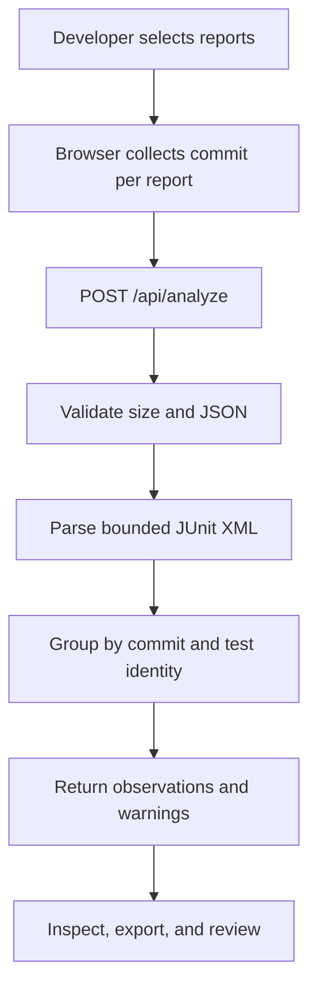

# Architecture, data model and verification

## Product boundary

Flakewise helps a developer review existing JUnit reports. It does not run arbitrary uploaded code, retrieve private repositories or automatically mutate issue trackers. The browser sends its reports to the analysis API; users should remove secrets from reports before using a public installation.

## Request flow



The service has no application database, user authentication or persistent report storage. Reports are processed transiently by the Python server; deployment providers may still collect operational logs. Do not promise zero retention outside application control.

## API contract

`POST /api/analyze` accepts `application/json`:

```json
{
  "runs": [
    {"name": "run-1.xml", "commit": "a1b2c3d4", "xml": "<testsuite><testcase classname=\"api\" name=\"test_fetch\"/></testsuite>"},
    {"name": "run-2.xml", "commit": "a1b2c3d4", "xml": "<testsuite><testcase classname=\"api\" name=\"test_fetch\"><failure message=\"timeout\"/></testcase></testsuite>"}
  ]
}
```

The response contains `runs`, `tests`, `summary` and `warnings`. Each test has a stable derived ID, asserted commit, `class_name`, `name`, `observations`, classification and outcome counts. Each observation includes the run name, pass/fail/skipped status, optional duration and bounded failure message. Errors return JSON with an `error` message and suitable HTTP status.

### Classification

| Observation within identical supplied commit + class + test | Label | Meaning |
| --- | --- | --- |
| At least one pass and one failure | `mixed` | Inconsistent observed outcomes; not a diagnosis |
| Two or more failures and no passes | `failed` | Repeated failures within supplied data |
| Two or more passes and no failures | `passed` | Repeated passes within supplied data |
| One non-skipped result | `insufficient` | Not enough observations to compare |
| Only skipped results | `skipped` | No pass or failure to compare |

Outcome groups for different commit strings stay separate. The user is responsible for correctly supplying commit identifiers. Hash prefixes are allowed for convenience but full hashes reduce ambiguity. Environment, test ordering and external data can differ even with identical commits.

## Storage model

There is no database schema. The in-memory logical entities are:

- `Run`: user-supplied unique display name, normalized commit and JUnit XML.
- `Observation`: one test result within one run: status, optional duration and sanitized message.
- `TestGroup`: asserted commit + class + test name, with observations and a classification.
- `Analysis`: run summaries, grouped tests, derived counts and explanatory warnings.

In-memory data is returned as a response and is not written to an application database. JSON export is generated for the user; no claim of signed provenance is made.

## Safety requirements

- Accept 1–12 reports, 512 KiB maximum per report, 2 MiB total XML and 3,000 observations. The HTTP body is capped separately.
- Reject DTD/entity declarations, malformed JUnit root elements, duplicate test identities per report, non-finite or negative durations, duplicate JSON keys, invalid commit IDs and unexpected input fields.
- For rendered results treat report-supplied names/messages as text. Never use them as HTML or shell commands.
- Require a matching HTTP Origin when present and reject cross-origin browser submissions. Return explicit errors without including whole report content.
- HTTPS/TLS, platform access controls, monitoring, and application rate limiting are deployment concerns. This stateless prototype should not be presented as a hardened multi-tenant platform.

## Test and release gates

Unit tests should cover JUnit parsing, same/different commit groups, failure/error/skipped semantics, repeated outcomes, invalid sizes, malformed XML and malicious input. Browser testing must exercise uploaded real reports, sample labeling, clear/reset, filters, selected-test details, export and error recovery on desktop and phone. Deployment verification must call the public endpoint and test the same workflows. Record results only after those tests actually run.

## Agent workflow status

A GitLab Duo flow or pipeline file is configuration until a real session executes it. The event entry needs visible GitLab CI/CD history and genuine GitLab Duo Platform use specific to Flakewise. Cite the actual session, draft merge request, commits and before/after job logs if and when they exist; do not reuse a different project's agent evidence as proof.
